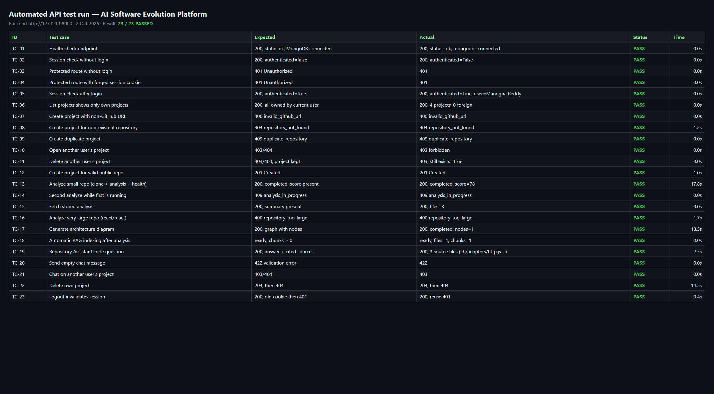
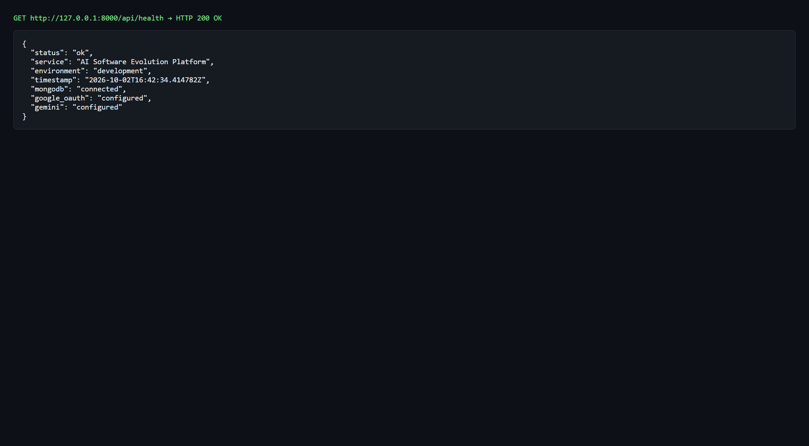
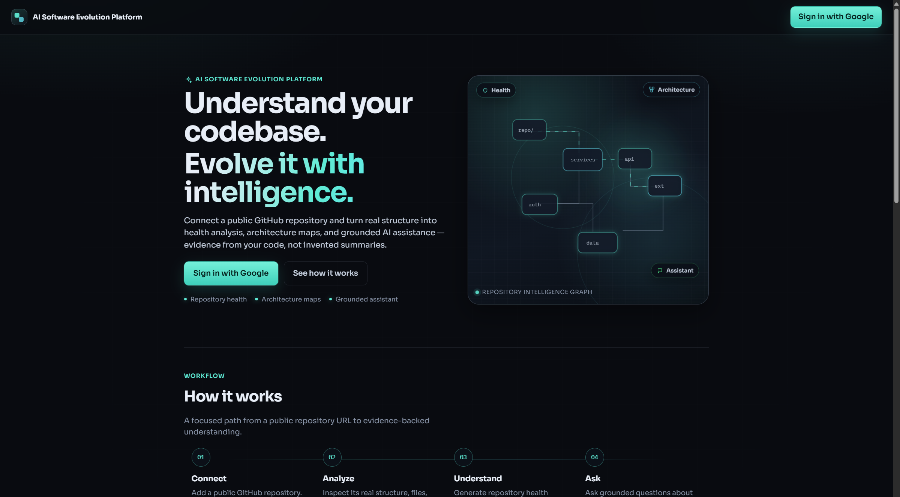
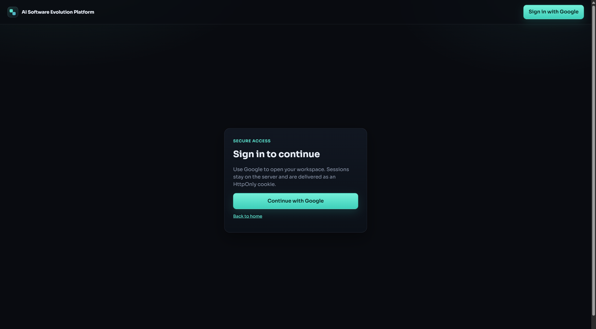
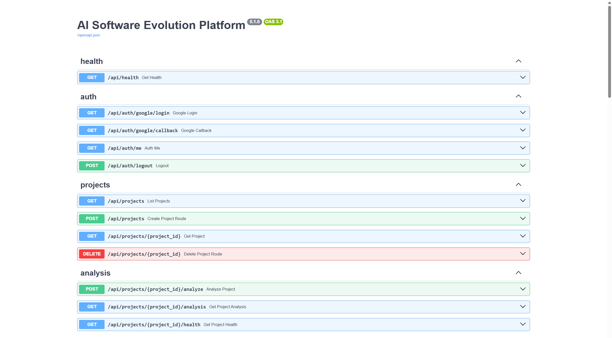

# Testing Documentation — AI Software Evolution Platform

**Test date:** 2 October 2026
**Environment:** Windows 11, Python 3.14 (FastAPI backend on `127.0.0.1:8000`), React + Vite frontend on `127.0.0.1:5173`, MongoDB 7 (local), ChromaDB (local), Gemini API (architecture + chat), sentence-transformers `all-MiniLM-L6-v2` (embeddings).

---

## 1. Testing approach

The platform was tested at two levels:

| Level | What it checks | How it was run |
|-------|----------------|----------------|
| **API (black-box) testing** | Each backend endpoint returns the correct status code, error code, and data for valid, invalid, and unauthorized inputs. | Automated script `backend/scripts/run_api_tests.py` sends real HTTP requests to the running backend and compares responses with the expected results. |
| **UI (functional) testing** | A user can complete every workflow in the browser: sign in, connect a repository, view health, generate architecture, chat, handle errors, and log out. | Manual execution in the browser following the steps in Section 4, with screenshots as evidence. |

### Types of testing covered

- **Functional testing:** each feature (auth, projects, analysis, health, architecture, chat) does what it is designed to do.
- **Negative / validation testing:** invalid URLs, missing repositories, empty messages, and duplicate projects are rejected with clear messages.
- **Security testing:** protected routes reject anonymous and forged sessions; a user can never read, chat with, or delete another user's project.
- **Boundary testing:** very large repositories (above ~400 MB on GitHub) are rejected before cloning instead of failing midway.
- **Concurrency testing:** a second analysis request for the same project while one is running is rejected (prevents two clones overwriting each other).
- **Integration testing:** analysis → health report → architecture → automatic RAG indexing → chat works end to end on a real public repository.

---

## 2. Test environment setup

1. Start MongoDB locally.
2. Start the backend: `cd backend` then `.\.venv\Scripts\uvicorn.exe app.main:app --host 127.0.0.1 --port 8000`
3. Start the frontend: `cd frontend` then `npm run dev`
4. Confirm `GET /api/health` returns `status: ok` and `mongodb: connected` (see TC-01).
5. Run the automated API tests: `cd backend` then `.\.venv\Scripts\python.exe scripts\run_api_tests.py`

The script creates its own temporary projects (`octocat/Spoon-Knife`, `react/react`) and deletes them at the end, so existing user data is not modified.

---

## 3. API test cases (automated)

**Result: 23 / 23 passed.**

### 3.1 System health

| ID | Test case | Input / steps | Expected result | Actual result | Status |
|----|-----------|---------------|-----------------|---------------|--------|
| TC-01 | Health check endpoint | `GET /api/health` | HTTP 200, `status: ok`, MongoDB connected, OAuth and Gemini configured | 200, `status=ok`, `mongodb=connected` | PASS |

**Explanation:** This is the first check before any demo or test run. It confirms the API process is running and can reach its dependencies (MongoDB, Google OAuth configuration, Gemini key) without exposing any secret values.

### 3.2 Authentication and sessions

| ID | Test case | Input / steps | Expected result | Actual result | Status |
|----|-----------|---------------|-----------------|---------------|--------|
| TC-02 | Session check without login | `GET /api/auth/me` with no cookie | 200, `authenticated: false` | 200, `authenticated=False` | PASS |
| TC-03 | Protected route without login | `GET /api/projects` with no cookie | 401 Unauthorized | 401 | PASS |
| TC-04 | Protected route with forged cookie | `GET /api/projects` with cookie `ase_session=forged-session-value` | 401 Unauthorized | 401 | PASS |
| TC-05 | Session check after login | `GET /api/auth/me` with a valid session | 200, `authenticated: true`, user details | 200, `authenticated=True`, user = Manogna Reddy | PASS |
| TC-23 | Logout invalidates session | `POST /api/auth/logout`, then reuse the old cookie on `GET /api/projects` | Logout 200; old cookie rejected with 401 | Logout 200, reuse 401 | PASS |

**Explanation:** Sessions are stored server-side in MongoDB and sent to the browser as an HttpOnly cookie (no JWT). These cases prove that (a) anonymous users cannot reach project data, (b) a made-up cookie value is not accepted because the server looks it up in the `sessions` collection, and (c) logging out deletes the session on the server, so a stolen copy of the cookie stops working immediately.

### 3.3 Project management and input validation

| ID | Test case | Input / steps | Expected result | Actual result | Status |
|----|-----------|---------------|-----------------|---------------|--------|
| TC-06 | List shows only own projects | `GET /api/projects` as Manogna | 200; every project's owner is the current user | 200, 4 projects, 0 belonging to other users | PASS |
| TC-07 | Non-GitHub URL | `POST /api/projects` with `https://gitlab.com/foo/bar` | 400 `invalid_github_url` | 400 `invalid_github_url` | PASS |
| TC-08 | Repository does not exist | `POST /api/projects` with `https://github.com/octocat/this-repo-does-not-exist-123` | 404 `repository_not_found` | 404 `repository_not_found` | PASS |
| TC-09 | Duplicate repository | `POST /api/projects` with `https://github.com/axios/axios` (already connected) | 409 `duplicate_repository` + id of existing project | 409 `duplicate_repository` | PASS |
| TC-12 | Valid public repository | `POST /api/projects` with `https://github.com/octocat/Spoon-Knife` | 201 Created, project id returned | 201, id returned | PASS |
| TC-22 | Delete own project | `DELETE /api/projects/{id}`, then `GET` the same id | 204, then 404 | 204, then 404 | PASS |

**Explanation:** Every URL is normalised and checked against the GitHub API before a project is saved, so users get an immediate, specific message (wrong site, repository missing, private, or already connected) instead of a failure later during cloning. Deleting a project also removes its analysis, architecture, chat index, and temporary clone folder.

### 3.4 Authorization (data isolation between users)

| ID | Test case | Input / steps | Expected result | Actual result | Status |
|----|-----------|---------------|-----------------|---------------|--------|
| TC-10 | Open another user's project | Manogna calls `GET /api/projects/{id}` for a project owned by a different user | 403 or 404; no project data returned | 403 `forbidden` | PASS |
| TC-11 | Delete another user's project | Manogna calls `DELETE` on that project | 403 or 404; project still exists in the database | 403; project still exists | PASS |
| TC-21 | Chat on another user's project | `POST /api/projects/{id}/chat` on that project | 403 or 404 | 403 | PASS |

**Explanation:** Every project-scoped route goes through an ownership check (`get_owned_project_dep`), so knowing or guessing a project id is not enough to read, modify, or query someone else's repository. The chat index in ChromaDB is also filtered by `project_id`, so answers can never include another project's code.

### 3.5 Repository analysis and health report

| ID | Test case | Input / steps | Expected result | Actual result | Status |
|----|-----------|---------------|-----------------|---------------|--------|
| TC-13 | Analyze a small repository | `POST /api/projects/{id}/analyze` on `octocat/Spoon-Knife` | 200, status `completed`, health report with overall score | 200, `completed`, score 78 (17.8 s) | PASS |
| TC-14 | Second analyze while first is running | Send a second `analyze` request 1 s after the first | 409 `analysis_in_progress` | 409 `analysis_in_progress` | PASS |
| TC-15 | Fetch stored analysis | `GET /api/projects/{id}/analysis` | 200, analysis summary with file counts | 200, 3 files | PASS |
| TC-16 | Very large repository | Create `react/react` (~1 GB on GitHub), then `analyze` | 400 `repository_too_large` with a clear message, no clone attempted | 400 `repository_too_large` (1.7 s) | PASS |

**Explanation:** Analysis performs a shallow clone into a temporary folder, walks the files, parses Python/JavaScript structure, and computes a health score from real evidence. TC-14 verifies the database lock that stops two clones of the same project running together (this race previously caused "Access is denied" clone failures on Windows). TC-16 verifies the size limit added after `react/react` failed to clone: the platform now rejects it in under 2 seconds with an explanation, instead of downloading 7,000+ files and failing.

### 3.6 Architecture generation

| ID | Test case | Input / steps | Expected result | Actual result | Status |
|----|-----------|---------------|-----------------|---------------|--------|
| TC-17 | Generate architecture diagram | `POST /api/projects/{id}/architecture/generate` | 200, status `completed`, graph with at least one node | 200, `completed`, 1 node (18.5 s) | PASS |

**Explanation:** The backend builds a compact summary of the stored analysis, asks Gemini for an architecture graph, and validates every node and edge against real files before saving it. Spoon-Knife is a 3-file static site, so a single component with no edges is the correct, non-fabricated result; larger repositories (e.g. axios, flask) produce multi-component graphs.

### 3.7 RAG indexing and Repository Assistant (chat)

| ID | Test case | Input / steps | Expected result | Actual result | Status |
|----|-----------|---------------|-----------------|---------------|--------|
| TC-18 | Automatic indexing after analysis | Poll `GET /api/projects/{id}/rag/status` after TC-13 | Status `ready`, chunk count > 0 | `ready`, 1 file, 1 chunk | PASS |
| TC-19 | Code question with sources | `POST /api/projects/{axios}/chat` with "Where are the HTTP adapters implemented?" | 200, answer text, at least one cited source file | 200, 3 sources: `lib/adapters/adapters.js`, `lib/adapters/http.js`, `lib/core/dispatchRequest.js` (2.5 s) | PASS |
| TC-20 | Empty chat message | `POST /api/projects/{axios}/chat` with `""` | 422 validation error | 422 | PASS |

**Explanation:** After analysis, the repository is split into chunks, embedded locally with sentence-transformers, and stored in ChromaDB tagged with the project id. A chat question retrieves the most relevant chunks for that project only and Gemini answers using them. TC-19 shows the answer is grounded: the cited files are the actual adapter files in the axios codebase.

---

## 4. UI test cases (manual)

Run these in the browser at `http://127.0.0.1:5173`. Fill in **Actual result** and **Status** while testing, and save each screenshot into `docs/screenshots/` with the file name listed.

| ID | Module | Test case | Steps | Expected result | Screenshot |
|----|--------|-----------|-------|-----------------|------------|
| UI-01 | Landing | Landing page loads | Open `http://127.0.0.1:5173/` | Hero section, "How it works" steps, and "Sign in with Google" button are shown | `01-landing-page.png` |
| UI-02 | Auth | Protected page redirects when logged out | While logged out, open `/dashboard` | Redirected to `/login` with "Sign in to continue" | `02-login-redirect.png` |
| UI-03 | Auth | Google sign-in | Click **Continue with Google**, choose account | Redirected to dashboard showing "Welcome back, &lt;first name&gt;" | `06-dashboard.png` |
| UI-04 | Dashboard | Repository cards | View dashboard after sign-in | Each repository card shows name, GitHub path, health ring, status, last analyzed time, detected stack | `06-dashboard.png` |
| UI-05 | Dashboard | Search repositories | Type `flask` in the search box | Only matching repositories are shown; non-matching query shows "No repositories found" | `07-dashboard-search.png` |
| UI-06 | Create project | Invalid URL rejected | **Analyze a Repository** → enter `https://gitlab.com/foo/bar` → submit | Red banner: "Enter a valid public GitHub repository URL…" | `08-create-invalid-url.png` |
| UI-07 | Create project | Duplicate repository | Enter `https://github.com/axios/axios` → submit | Error banner plus "This repository is already connected. Open existing project" link | `09-create-duplicate.png` |
| UI-08 | Analysis | Large repository rejected | Create `https://github.com/react/react` → analysis starts automatically | Banner: "Repository 'react/react' is too large for local analysis (~1055 MB…)" | `10-large-repo-rejected.png` |
| UI-09 | Workspace | Overview panel | Open the axios project | Overview with repository summary, detected stack, and key findings | `11-workspace-overview.png` |
| UI-10 | Health | Health report | Click **Health** | Overall score ring, category breakdown, issues and recommendations | `12-health-report.png` |
| UI-11 | Architecture | Architecture diagram | Click **Architecture** → **Generate** (or view existing) | Interactive diagram with components and connections; pan/zoom works | `13-architecture.png` |
| UI-12 | Assistant | Grounded chat answer | Click **Repository Assistant** → ask "Where are the HTTP adapters implemented?" | Answer with "Repository grounded" badge; **Sources** expands to file paths and excerpts | `14-assistant-chat.png` |
| UI-13 | Error handling | Backend unavailable | Stop the backend, refresh the dashboard | Banner "Cannot reach the API. Start the backend…" with **Retry** and **Dismiss** buttons | `15-backend-down.png` |
| UI-14 | Auth | Logout | Open the user menu → **Log out** | Returned to landing page; opening `/dashboard` redirects to login again | `16-logout.png` |

### Captured UI evidence

**UI-01 — Landing page**

**UI-02 — Logged-out visit to `/dashboard` redirects to login**

---

## 5. API reference used during testing

The Swagger page at `http://127.0.0.1:8000/docs` lists every endpoint that was tested.

---

## 6. Defects found and fixed during testing

| ID | Defect | Root cause | Fix | Verified by |
|----|--------|------------|-----|-------------|
| BUG-01 | Analyzing `react/react` showed only "Failed to clone the GitHub repository." | Repository is ~1 GB with 7,000+ files; the clone was slow and on Windows hit "Access is denied" file locks on git pack files. Disk space was **not** the cause (~275 GB free). | Repositories above ~400 MB are rejected before cloning with a clear message; clones use `core.longpaths=true`; clone errors now show the real git reason. | TC-16, UI-08 |
| BUG-02 | Retrying analysis quickly could break the running clone | Cleanup deleted the whole project clone folder while another request was still cloning into it. | Atomic "claim" of the project status in MongoDB (only one analysis at a time) and cleanup of only that run's folder. | TC-14 |
| BUG-03 | Network failures showed raw "Failed to fetch" text | Browser fetch errors were not translated. | All API calls map network failures to "Cannot reach the API…" with Retry/Dismiss banners. | UI-13 |

---

## 7. Summary

| Category | Test cases | Passed | Failed |
|----------|-----------|--------|--------|
| System health | 1 | 1 | 0 |
| Authentication and sessions | 5 | 5 | 0 |
| Project management and validation | 6 | 6 | 0 |
| Authorization (data isolation) | 3 | 3 | 0 |
| Analysis and health report | 4 | 4 | 0 |
| Architecture generation | 1 | 1 | 0 |
| RAG and Repository Assistant | 3 | 3 | 0 |
| **Total (automated API)** | **23** | **23** | **0** |
| UI (manual) | 14 | — | — |

All automated API test cases passed. The UI test cases cover the same features from the user's point of view; their results and screenshots are recorded in Section 4.
